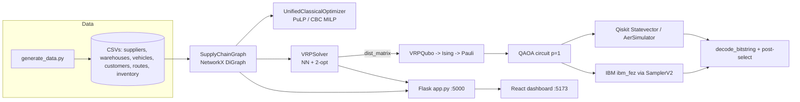

# PROJECT_OVERVIEW.md — Quantum-Ready Supply Chain Optimizer (Team Semicolons, IBM Quantum Hackathon 2025)

> Purpose of this file: a complete hand-off description of what exists in this folder, so another assistant (e.g. Copilot) can understand the current state before proposing an upgrade / new prototype.

---

## 1. What the project is

An end-to-end demo that takes a supply-chain optimisation problem (suppliers -> warehouses -> customers), solves it two ways, and shows both in a web dashboard:

1. **Classical**: a unified MILP (PuLP/CBC) for supplier selection + inventory + flow, plus a nearest-neighbour + 2-opt VRP heuristic.
2. **Quantum**: the Vehicle Routing Problem (VRP) encoded as a **QUBO -> Ising -> QAOA** circuit (Qiskit), tested on a local simulator and submitted to real IBM hardware (`ibm_fez`, job `d84c4k80bvlc73d4dg9g`, 16 qubits = 4 customers x 4 positions x 1 vehicle).

Claims in README / UI text (taken from README and frontend, NOT computed by backend code): 15.1% cost reduction of unified MILP vs sequential pipeline; classical "scaling wall" at ~28-35 nodes; 681-gate transpiled circuit; 4096 shots.

---

## 2. Folder layout

```
/
├── README.md                    Project pitch, run instructions, IBM key setup
├── PROJECT_OVERVIEW.md          (this file)
├── backend/                     Python: optimisation + quantum + REST API
│   ├── app.py                   Flask API (port 5000, CORS enabled)
│   ├── main.py                  CLI pipeline (graph -> MILP -> VRP classical vs QAOA sim)
│   ├── submit_job_ibm.py        Build 16-qubit QAOA, pre-optimise locally, submit to IBM (SamplerV2, 4096 shots)
│   ├── fetch_job_ibm.py         Fetch job by ID, decode bitstrings, compare to classical
│   ├── scaling_demo.py          "Classical wall" demo (2^N array brute force vs constant 5 s QPU)
│   ├── demo_advantage.py        "Algorithmic advantage" demo on the trap dataset (data_advantage/)
│   ├── generate_advantage_data.py  Generates trap dataset (not read in detail)
│   ├── inject_trap.py           Rewrites data_advantage/routes.csv so greedy NN fails
│   ├── requirements.txt
│   ├── graph/network_builder.py     SupplyChainGraph (NetworkX DiGraph from CSVs)
│   ├── classical/
│   │   ├── unified_optimizer.py     Main MILP (suppliers + flows + deadlines + risk)
│   │   ├── vrp_solver.py            Nearest-neighbour + 2-opt VRP heuristic
│   │   ├── supplier_selector.py     Weighted-score greedy supplier selection (legacy)
│   │   └── inventory_optimizer.py   LP inventory allocation (legacy)
│   ├── quantum/vrp_qaoa.py          VRPQubo, Ising/Pauli conversion, QAOA circuit, sim run, decoder
│   ├── data/                        Main dataset generator (generate_data.py) + CSVs it writes
│   └── data_advantage/              Trap dataset for the advantage demo (generate_data.py + CSVs)
└── frontend/                    React 19 + Vite 8 dashboard
    ├── package.json, vite.config.js, eslint.config.js, index.html
    ├── Semicolons_Supply_Chain.ppt  Project presentation (demo video also referenced as being here)
    ├── public/scrolleffect2/        192 WebP frames for scroll animation
    ├── public/ibm-circuit/          Screenshots of the IBM transpiled circuit / Qiskit code / results
    ├── public/group-photo.jpeg
    └── src/
        ├── main.jsx, App.jsx, index.css, App.css
        ├── components/ScrollHero.jsx   Scroll-driven canvas animation (192 frames from /scrolleffect2)
        └── pages/ Home, Dashboard, ClassicalArchitecture, QuantumAdvantage, Comparison
```

Note: the CSVs exist in `backend/data/` and `backend/data_advantage/` (e.g. `routes.csv` confirmed). To regenerate the main dataset use `python main.py --generate-data` (writes to `data/`). Regenerating overwrites the data the README numbers were based on.

---

## 3. Architecture



### Backend modules

| Module | Role | Key details |
|---|---|---|
| `graph/network_builder.py` | Loads 6 CSVs, builds DiGraph | Node types supplier/warehouse/customer; edge attrs distance, cost (= dist x cost_per_km), travel_time; `summary()`, `shortest_path()` |
| `classical/unified_optimizer.py` | Single MILP | Vars: `y_s` binary supplier selection, `x_sw` supplier->warehouse flow, `z_wc` warehouse->customer flow. Objective: unit cost + transport/1000 + holding + supplier penalty (reliability/lead time/capacity) + synthetic route risk (seeded 42). Constraints: supplier cap x y, flow conservation, storage cap, fleet cap, exact demand, deadline (travel_hrs/24 <= deadline). Missing routes get penalty 999. Solver: CBC |
| `classical/vrp_solver.py` | VRP heuristic | Per warehouse, per vehicle: nearest-neighbour respecting `capacity_kg` vs `demand_units`, then 2-opt; haversine fallback for missing edges; returns `routes_df`, total distance/cost, unserved |
| `quantum/vrp_qaoa.py` | Quantum core | `VRPQubo`: variable x[customer, position k, vehicle], n = C*K*V qubits. Terms: travel cost, capacity penalty (disabled with lam_cap=0), visit-once, one-customer-per-position (lam 40000 each). `to_ising`, `ising_to_pauli`, `build_qaoa_circuit` (H, RZ/CX-RZ-CX cost layer, RX mixer), COBYLA param optimisation on exact statevector, sampling on Aer, brute-force optimum if n <= 12, `decode_bitstring` -> route/cost/dist |
| `app.py` | REST API | See endpoints below |
| `submit_job_ibm.py` / `fetch_job_ibm.py` | Hardware pipeline | Uses `QiskitRuntimeService(channel="ibm_quantum_platform")`, `least_busy(min_num_qubits=16)`, transpile opt level 3; fetch takes top-3 valid bitstrings (visits every customer exactly once), falls back to classical result if quantum cost is higher |
| `scaling_demo.py` | Console demo | Times `np.random.rand(2**n)` for n up to 26 vs fixed 5 s "QPU" |
| `demo_advantage.py` | Console demo | Enumerates permutations on trap dataset; **classical/quantum costs and route strings are hard-coded print statements** ($22,992.30 vs $10,475.30) |

### REST API (`backend/app.py`, Flask, CORS open)

| Endpoint | Returns |
|---|---|
| `GET /api/network` | nodes (id, type, lat, lon) + edges (source, target, distance) |
| `GET /api/shipment_plan` | VRPSolver result over full dataset: total cost/distance, per-vehicle routes (type, warehouse, path, km, units) |
| `GET /api/scaling_data` | **Modelled (not measured)** curve: classical `2^n * n^2 * 1e-8` s vs QAOA `5 + 0.005*n^2.5` s for n in [5..40] |
| `GET /api/dataset_overview` | Entity counts + first 7 suppliers / 5 warehouses / 8 customers |

Every request re-reads CSVs and rebuilds the graph (no caching).

### Frontend

- Stack: React 19, react-router-dom 7, axios, recharts, lucide-react, Vite 8, ESLint.
- Routes: `/` Home (ScrollHero + team photo), `/dashboard`, `/classical`, `/quantum` ("Quantum Theory": energy landscape, superposition explorer, IBM circuit images), `/research` (Research Pipeline), `/comparison`.
- API usage found: `Dashboard.jsx` -> `/api/scaling_data`, `/api/dataset_overview`; `Comparison.jsx` -> `/api/scaling_data`. The API base URL `http://127.0.0.1:5000` is hard-coded. `/api/network` and `/api/shipment_plan` were not found called from the frontend (ClassicalArchitecture.jsx was not read in detail, so it may use static data).

---

## 4. Data model (CSV, synthetic, seed 42, India-like lat/lon box)

| File | Columns |
|---|---|
| suppliers.csv | supplier_id (S1-S8), name, lat, lon, capacity, cost_per_unit, lead_time_days, reliability_score, is_active |
| warehouses.csv | warehouse_id (W1-W5), name, lat, lon, storage_capacity, holding_cost_per_unit, fixed_cost |
| vehicles.csv | vehicle_id (V1-V15), type, capacity_kg, cost_per_km, speed_kmph, warehouse_id |
| customers.csv | customer_id (C1-C10), name, lat, lon, demand_units, priority, delivery_deadline_days |
| routes.csv | from_node, to_node, distance_km (haversine, <= 800 km), cost_per_km, travel_time_hrs (= dist/60) |
| inventory.csv | warehouse_id, supplier_id, current_stock, reorder_point, order_quantity (not used by the optimizers) |

---

## 5. How to run

```bash
# Backend
cd backend
pip install -r requirements.txt
pip install flask flask-cors qiskit-ibm-runtime   # missing from requirements.txt
python main.py --generate-data   # optional, creates CSVs
python app.py                    # API on :5000
python demo_advantage.py
python scaling_demo.py

# IBM hardware
export IBM_QUANTUM_API_KEY=...
python submit_job_ibm.py         # prints Job ID
python fetch_job_ibm.py <JOB_ID>

# Frontend
cd frontend && npm install && npm run dev   # :5173
```

---

## 6. Known gaps / issues (important before upgrading)

1. **requirements.txt incomplete**: no `flask`, `flask-cors`, `qiskit-ibm-runtime`; lists `streamlit`, `plotly`, `python-pptx` that the code does not use.
2. **Duplicated file content**: `classical/inventory_optimizer.py` and `fetch_job_ibm.py` each contain their whole source twice (second copy is dead/duplicate). Clean up.
3. **Bug in `fetch_job_ibm.py`**: the first `except AttributeError` only assigns `register_name` and never sets `counts` (the later retry block does it correctly).
4. **`demo_advantage.py` is largely scripted**: results and route strings are hard-coded, the computed `best_q` and `c_cost` are never printed. Not a real measured advantage.
5. **`/api/scaling_data` is a theoretical model** with assumed constants; `scaling_demo.py` hard-codes the QPU time at 5 s. Treat "quantum advantage" claims as illustrative. Also, QAOA on NISQ hardware with a 681-gate circuit is noise-limited; the 16-qubit result relied on post-selection and a classical fallback.
6. **`main.py --qiskit` flag is unused** (docstring mentions Simulated Annealing, which does not exist). `UnifiedClassicalOptimizer` result is not compared with a sequential pipeline in code, so the "15.1%" figure is not reproducible from this repo as-is: it is hard-coded in `frontend/src/pages/ClassicalArchitecture.jsx` ($68,420 sequential vs $58,110 unified, saving $10,310). The "681 gates", "65,536 states" and job ID are likewise static text in `QuantumAdvantage.jsx`. README claims the hardware result matched the simulator, but `fetch_job_ibm.py` post-selects valid bitstrings and falls back to the classical route if quantum cost is higher. Legacy `supplier_selector.py` / `inventory_optimizer.py` are not wired in.
7. **QUBO limits**: qubits = C*K*V (cubic growth), capacity penalty disabled (`lam_cap=0`), one-hot penalties very large (40000), only single warehouse / 1-4 customers feasible. Brute-force check only for n <= 12.
8. **API**: no caching, `debug=True`, hard-coded CORS-open, hard-coded frontend URL, relative `data_dir="data"` in scripts (must run from `backend/`).
9. **Security**: IBM key fallback string in code; keep using the env var and never commit keys.
10. **Mixed units**: VRP compares `demand_units` with `capacity_kg`; MILP assumes a 1000-unit truck for per-unit costs.
11. **No tests, no CI, no Docker, no .env handling.**

---

## 7. Suggested starting points for an upgrade

- Fix requirements, remove duplicated code, add `.env` + config module.
- Replace hard-coded demo output with computed results; add a reproducible benchmark (classical sequential vs unified vs QAOA) and store results as JSON for the UI.
- Add a pluggable solver interface (classical / simulator / IBM) and a job-status endpoint (`/api/quantum/jobs`) instead of CLI-only submit/fetch.
- Reduce qubit count with better encodings (e.g. TSP permutation encodings, CVaR-QAOA, warm start) and add error mitigation.
- Frontend: env-based API URL (`import.meta.env.VITE_API_URL`), use `/api/network` and `/api/shipment_plan` for a live map, add loading/error states.
- Add tests (pytest for QUBO validity: valid permutations have lowest energy), Dockerfile / docker-compose, CI.

---

## 8. Research architecture migration status

The original VRP/MILP implementation remains available for legacy routes and CLI
workflows. The research prototype is implemented alongside it rather than replacing
working code or changing existing dashboard response shapes.

### Active research flow

```text
customers.csv
  -> geographic KMeans clusters and centroids
  -> two nearest candidate warehouses per cluster
  -> position QUBO (2 * customers_in_cluster^2 binary variables)
  -> selected RQAOA or QIRO reduction from shot-based QAOA expectations on Aer
     (matrix-product-state backend, bond dimension <= 64; no 32-qubit statevector)
  -> exact affine QUBO substitutions and per-iteration measurement history
  -> existing Warm Start QAOA on a local statevector simulator (at most 20 variables)
  -> reconstructed original bitstring, warehouse, sequence and energy
```

RQAOA selects the pair with the strongest measured `|<ZiZj>|` and substitutes
its measured equality or anti-equality relation. QIRO fixes variables from
measured single-spin bias and applies pair inference when no single-spin
expectation passes the configured threshold. Both algorithms use Aer shot
counts, record their expectation/correlation evidence, and make no reduction
decisions from the classical feasible seed. IBM hardware is disabled for this
workflow. The legacy Warm Start QAOA implementation remains unchanged.
The bounded MPS simulator is approximate (`max_bond_dimension=64`,
`truncation_threshold=1e-10`); these settings and each 2048-shot correlation
matrix are persisted. Reduction optimizes the first p=1 angles by shot-based
COBYLA and transfers them to later recursive levels by default.
Measured relations need not preserve a feasible original route. The pipeline
looks for a feasible Warm Start initializer only after reduction and reports
failure if none is reconstructable; it does not modify the quantum-selected
reduction decisions.

The current checked-in customer dataset has 10 rows, not 20+. The requested
four-customer cluster produces 32 variables; real cluster sizes are not padded or
fabricated. Smaller clusters can already fit the 20-variable limit and therefore
do not need elimination. KMeans requests four clusters by default and errors
explicitly when the input is too small.

### Migration inventory

**Keep**

- `backend/quantum/vrp_qaoa.py`: preserved legacy QAOA implementation.
- `backend/graph/network_builder.py`, `backend/classical/unified_optimizer.py`,
  `backend/classical/vrp_solver.py`, `backend/data/`: legacy supply-chain and
  shipment-plan functionality retained for compatibility.
- `frontend/`: existing React routes and payload consumers remain unchanged.

**Modify**

- `backend/app.py`: retains `/api/network`, `/api/shipment_plan`,
  `/api/scaling_data`, and `/api/dataset_overview`; adds `POST /api/research/run`
  and `GET /api/research/results`, with selectable RQAOA/QIRO modes.
- `backend/requirements.txt`: declares Flask/CORS, scikit-learn, and IBM Runtime
  dependencies used by the new API, KMeans, and opt-in hardware adapter.
- `frontend/src/App.jsx`: adds the Research Pipeline navigation item and route;
  existing page components are unchanged.
- `frontend/src/pages/ResearchPipeline.jsx` and
  `frontend/src/pages/ResearchPipeline.css`: add the research dashboard, results
  charts, measured correlation display, loading/error states, and simulator-only
  run action.
- `PROJECT_OVERVIEW.md`: documents the new architecture and migration boundaries.

**Deprecate from the research core (retain as legacy code)**

- `backend/classical/vrp_solver.py` as the new pipeline's optimization method;
  it still backs the existing shipment-plan API.
- `backend/classical/supplier_selector.py`,
  `backend/classical/inventory_optimizer.py`, `backend/demo_advantage.py`,
  `backend/scaling_demo.py`, and the trap-data scripts as research-pipeline
  dependencies. They are not deleted and are not called by the new pipeline.

**Create**

- `backend/outer_layer/`: KMeans clustering, visualization, great-circle distance
  matrices, position-variable/QUBO construction, decoding, and improvement loop.
- `backend/inner_layer/`: reduced-QUBO affine bookkeeping, shot-based Aer
  RQAOA/QIRO estimators, the existing feasible-seeded Warm Start QAOA, bounded
  exact fallback, and a disabled IBM Runtime adapter.
- `backend/classical/{baseline_solver,cp_sat_solver,gurobi_solver}.py` and
  `backend/evaluation/`: small-instance and optional solver entry points, plus
  feasibility and reduction metrics. OR-Tools and Gurobi are optional and are
  reported as unavailable rather than silently substituted.
- `backend/tests/`: focused clustering, QUBO, reduction, QAOA, and hardware-gate
  tests.

### API, experiment output, and hardware policy

Call `POST /api/research/run` with an optional JSON object:

```json
{"n_clusters": 4, "target_variables": 20, "run_hardware": false}
```

The endpoint returns clusters, centroids, assignments, reduction history, and
experiment records. It writes `results.json`, `assignments.json`,
`reduction_history.json`, and `experiment_log.json` beneath `backend/output/`.
Existing frontend API endpoints and their response schemas are unchanged.

The IBM adapter is reached only when `run_hardware` is explicitly true. The
pipeline first reduces to at most 20 active variables and runs simulator QAOA;
hardware is blocked if simulator decoding is infeasible. Submission also requires
`IBM_QUANTUM_API_KEY` and uses the least-busy operational IBM backend with enough
qubits. No hardware submission is performed by default.

### Validation

From `backend/`, install `requirements.txt`, then run:

```bash
python -m pytest tests
```

The tests exercise 32-variable construction for a four-customer cluster,
feasibility decoding, affine energy preservation during elimination, simulator
QAOA on a small instance, and pre-submission hardware guards. Optional CP-SAT and
Gurobi solvers require their respective separately installed packages.
